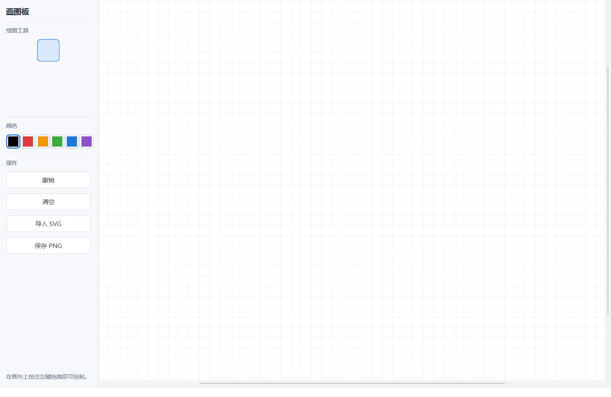
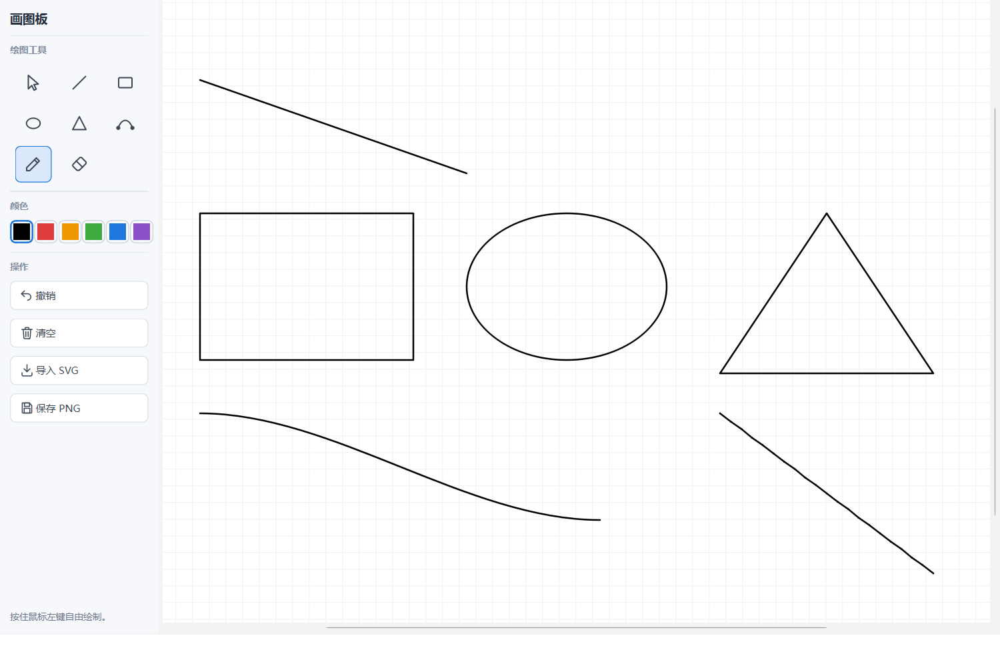
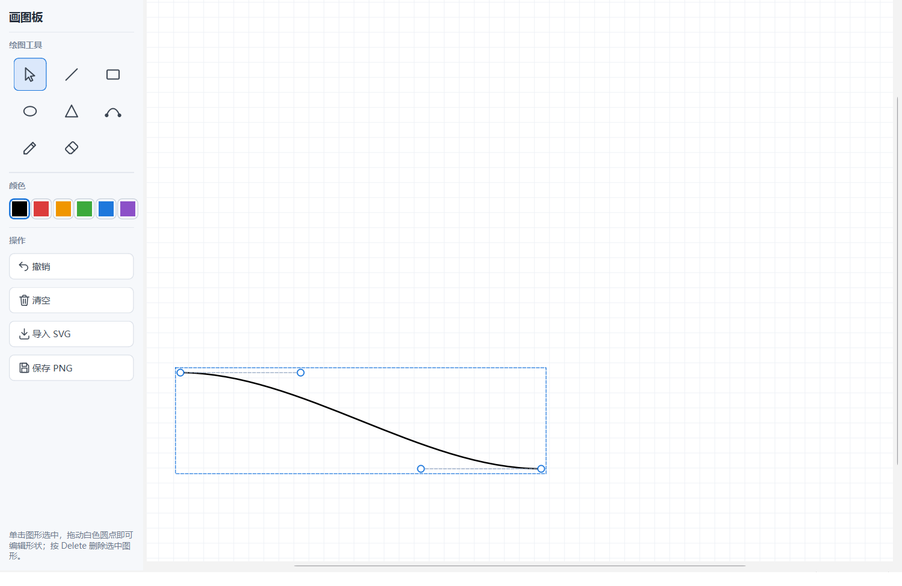
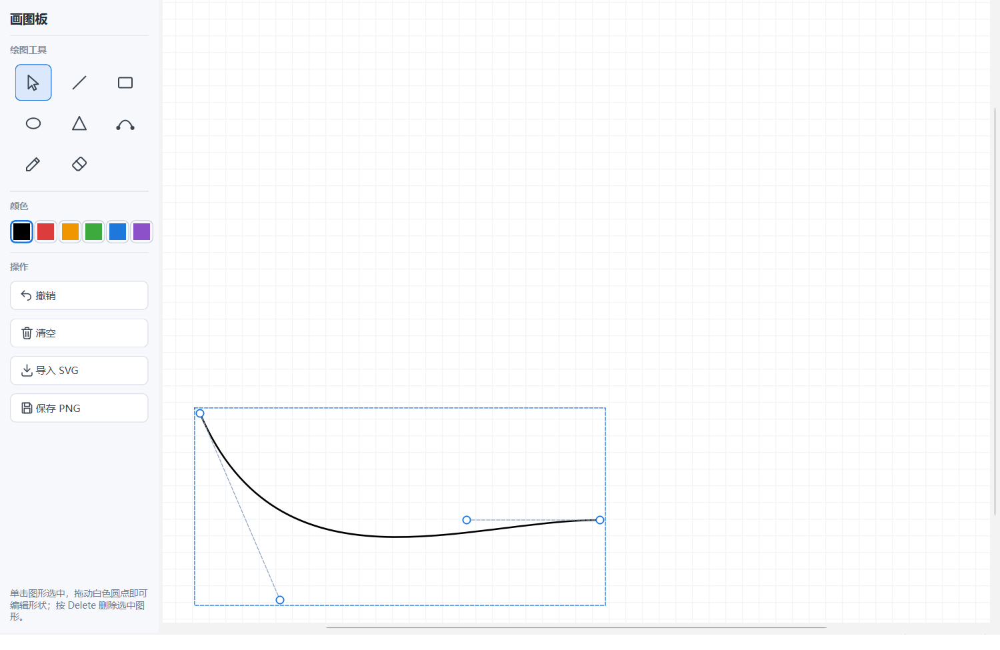
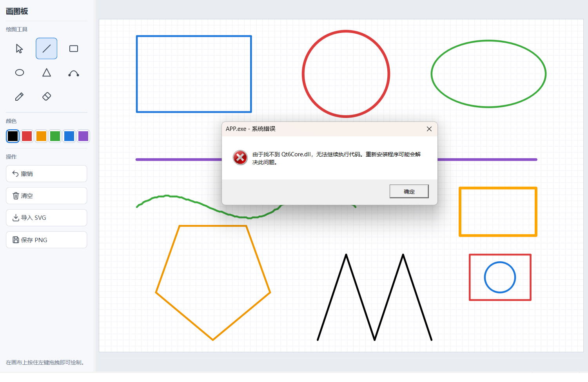

# 画图板（Qt6 / CMake / VS Code）

按《绘图功能开发与代码架构调整沟通》的要求改造的 Qt 画图板工程：

- 绘图能力封装成**独立静态库**，由外层 `mainwindow` 调用
- 新建**继承 `QGraphicsItem`** 的自定义图元类，实现直线、矩形、椭圆、三角形、**贝塞尔曲线**等绘制
- 实现**图形节点拖拽编辑**（拖动控制点改形状）
- **SVG 矢量导入**（真解析成可编辑图形，不是贴图）
- 全部控件用**代码**编写，工程里**没有任何 `.ui` 文件**
- **左右分栏**布局，左侧功能区使用图标按钮
- 开发工具：VS Code + CMake（不用 Qt Creator）

已在 MinGW GCC 13.1.0 + Qt 6.10.2 + CMake 3.30.5 + Ninja 下实测编译运行通过。

> **想了解每部分代码在哪、逻辑是什么、要改怎么改** → 见 [docs/AI生成代码位置与逻辑说明.md](docs/AI生成代码位置与逻辑说明.md)

---

## 一、环境

| 工具 | 本机路径 | 版本 |
| --- | --- | --- |
| CMake | `D:\qt\Tools\CMake_64\bin` | 3.30.5 |
| Ninja | `D:\qt\Tools\Ninja` | 1.12.1 |
| MinGW GCC | `D:\qt\Tools\mingw1310_64\bin` | 13.1.0 |
| Qt | `D:\qt\6.10.2\mingw_64` | 6.10.2 |
| VS Code | `D:\Microsoft VS Code` | |

**换电脑**：改 `CMakePresets.json` 里的 `CMAKE_PREFIX_PATH` 和编译器路径，以及 `.vscode/settings.json` 里的 Qt 头文件路径。

---

## 二、工程结构

```
PaintQt/
├─ CMakeLists.txt          顶层：找 Qt、加四个子目录
├─ CMakePresets.json       VS Code / 命令行构建预设
├─ .vscode/settings.json   插件配置
│
├─ draw/                   【静态库①】图形数据，不依赖 Qt
│   ├─ include/Draw.h
│   └─ src/Draw.cpp
│
├─ qtcanvas/               【静态库②】Qt 画布封装
│   ├─ include/QtRenderer.h    draw::Renderer → QPainter 的桥
│   ├─ include/ShapeItem.h     继承 QGraphicsItem 的自定义图元
│   ├─ include/CanvasScene.h   场景：工具状态 + 画图交互
│   ├─ include/CanvasView.h    视图：白纸 + 网格 + 缩放
│   └─ src/*.cpp
│
├─ svgio/                  【静态库③】SVG 解析
│   ├─ include/SvgImport.h
│   └─ src/SvgImport.cpp
│
├─ APP/                    【主程序】左右分栏界面
│   ├─ main.cpp
│   └─ icons/*.svg             左侧功能区 12 个图标
│
├─ samples/shapes.svg      测试用的 SVG
└─ docs/                   说明文档 + 运行截图
```

**依赖方向（单向不循环）：**

```
APP ──► qtcanvas ──► draw
  ├───► svgio   ──► draw
  └───► Qt6::Widgets / Qt6::Svg
```

### 为什么 `draw` 库不依赖 Qt

绘图类如果直接写 `QPainter`，将来换界面框架就得整个重写。现在 `draw` 只声明自己的 `Renderer` 抽象接口，Qt 只是它的一个实现（`QtRenderer`）。这样"独立绘图类"是真的独立。

---

## 三、在 VS Code 里构建运行

1. 用 VS Code 打开 `PaintQt` 文件夹
2. 装两个扩展：**C/C++**（`ms-vscode.cpptools`）、**CMake Tools**（`ms-vscode.cmake-tools`）
3. CMake Tools 会自动读取 `CMakePresets.json`，底部状态栏选 **mingw-debug**
4. `F7` 生成，`F5` 调试运行

## 四、命令行构建

```powershell
$env:PATH = "D:\qt\Tools\mingw1310_64\bin;D:\qt\Tools\Ninja;D:\qt\Tools\CMake_64\bin;" + $env:PATH

cmake --preset mingw-debug
cmake --build --preset mingw-debug
```

产物：

```
build/mingw-debug/draw/libdraw.a           图形数据
build/mingw-debug/qtcanvas/libqtcanvas.a   Qt 画布
build/mingw-debug/svgio/libsvgio.a         SVG 解析
build/mingw-debug/bin/APP.exe              主程序
```

运行前要把 Qt 的 DLL 目录加进 PATH：

```powershell
$env:PATH = "D:\qt\6.10.2\mingw_64\bin;" + $env:PATH
.\build\mingw-debug\bin\APP.exe

# 也可以直接带一个 SVG 打开（方便测试）
.\build\mingw-debug\bin\APP.exe .\samples\shapes.svg
```

发布时用 `windeployqt` 把 Qt 运行库拷到 exe 旁边：

```powershell
D:\qt\6.10.2\mingw_64\bin\windeployqt.exe build\mingw-debug\bin\APP.exe
```

---

## 五、操作说明

| 操作 | 说明 |
| --- | --- |
| **绘图工具** | 直线 / 矩形 / 椭圆 / 三角形 / 贝塞尔曲线 / 铅笔 / 橡皮擦，在画布上按住左键拖拽 |
| **选择工具** | 单击图形选中；拖动**白色圆点**编辑形状；拖动图形本体整体平移；按 `Delete` 删除 |
| **贝塞尔曲线** | 拖出一条 S 形曲线后，用选择工具拖它的 4 个控制点调整弧度（控制点之间会显示虚线控制多边形） |
| **颜色** | 左侧 6 个色块 |
| **撤销** | `Ctrl+Z`，或左侧「撤销」按钮 |
| **清空** | 左侧「清空」按钮 |
| **导入 SVG** | 左侧「导入 SVG」按钮；解析成可编辑图形后自动缩放到画布居中 |
| **打开位图** | 左侧「打开位图」按钮，支持 PNG / JPG / BMP / GIF / TIF；图片放到画布中央并自动选中 |
| **位图滤镜** | 「转灰度」「边缘检测」都基于**原图**计算，反复点不会越叠越糊 |
| **魔棒抠图** | 点「魔棒抠图」→ 在位图上点一下要**保留**的区域，颜色相近的留下、其余变透明（容差默认 40） |
| **还原原图** | 把位图恢复成刚打开时的样子 |
| **保存 PNG** | `Ctrl+S`，或左侧「保存 PNG」按钮（只导出有内容的范围） |
| **缩放画布** | `Ctrl + 滚轮` |

---

## 六、SVG 导入支持范围

| 元素 / 特性 | 支持情况 |
| --- | --- |
| `rect` `circle` `ellipse` `line` `polygon` `polyline` | ✅ |
| `path`：`M L H V C S Q T Z` | ✅ 贝塞尔按曲线长度自适应离散 |
| `path`：`A` 圆弧 | ⚠️ **简化为直线**，界面上会提示有几段被简化 |
| `transform`：translate / scale / rotate / matrix / skew | ✅ |
| `style="..."` 与表现属性（stroke / stroke-width） | ✅ `style` 优先级更高 |
| 颜色：`#RGB` `#RRGGBB` `rgb()` 常用颜色名 | ✅ |
| `g` 分组、`viewBox`、嵌套变换 | ✅ |
| 渐变 / 图案 / 文字 / `<use>` | ❌ 跳过，`Result.skipped` 里计数 |
| 填充 `fill` | ❌ 只画轮廓（没有 `stroke` 时会借用 `fill` 的颜色当线色） |

---

## 七、运行截图

| | |
| --- | --- |
|  |  |
| 主界面：左右分栏 + 图标功能区 | 六种图形全部绘制成功 |
|  |  |
| 选中后显示节点手柄与控制多边形 | 拖动控制点，曲线实时改变形状 |
|  | |
| SVG 导入：8 类元素 + 颜色 + transform 分组全部正确 | |

---

## 八、已知限制

- 撤销只按图形粒度回退，**节点编辑的历史不单独记录**（编辑完再撤销会整条图形消失）
- 橡皮擦是"用背景色画粗线"，只能擦白底，擦不掉背景图片
- 没有做文件保存/打开自己的格式（只导出 PNG）

以上都在 [docs/AI生成代码位置与逻辑说明.md](docs/AI生成代码位置与逻辑说明.md) 的第五节里列了改法。
